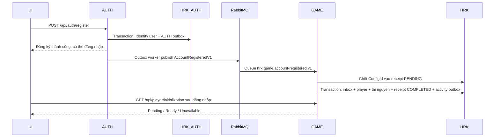

# Đăng ký tài khoản và tách database AUTH

## Luồng chạy



AUTH dùng cùng một `AuthDbContext` cho Identity và `IOutboxWriter`, thông qua typed UnitOfWork. Nếu ghi outbox thất bại, user cũng rollback. Các phiên đăng nhập, refresh token và application route config tiếp tục dùng `ApplicationDbContext`, cùng trỏ vào **HRK_AUTH**. Event không chứa email, mật khẩu hay token. API đăng ký không nhận role; ứng dụng phải tồn tại và đang active trong route config.

GAME nhận event bằng named consumer, gọi `ICqrsDispatcher` rồi `InitializePlayerCommand`. Chỉ event có `AppCode = dcs-game` mới tạo player. Không cần gọi HTTP hoặc có HttpContext trong consumer.

`HRK_PlayerInitializations.UserId` là duy nhất và được giữ lâu dài. Inbox có thể dọn theo retention mà không làm mất cơ chế chống cấp trùng. Khóa SQL application lock theo UserId bảo vệ cả trường hợp nhiều event ID hoặc nhiều instance xử lý cùng user. Player cũ được ghi nhận hoàn tất, không thay đổi tiến độ và không nhận lại gói khởi tạo.

Gói được chốt trong transaction riêng trước khi cấp. Nếu transaction cấp quà lỗi, receipt vẫn PENDING và giữ nguyên ConfigId. Transaction cấp bao gồm player, ví, tướng, thuộc tính sao, lịch sử nhận tướng, đội hình, vật phẩm, activity outbox và trạng thái COMPLETED. Tướng mới dùng chung `NewPlayerHeroFactory` với chiêu mộ; EXP, chỉ số và lực chiến đi qua các service hiện có. Vật phẩm dùng `GameRewardGranter`, kể cả trang bị. Không đủ chỗ nhận toàn bộ vật phẩm sẽ rollback.

Tên player ban đầu là `<FullName> #<PlayerId>` để hai tài khoản chọn cùng tên vẫn tạo được nhân vật. Email tiếp tục là tên đăng nhập AUTH.

## Sở hữu dữ liệu

**HRK_AUTH** chứa:

- Identity: HRK_Users, HRK_Roles, HRK_UserRoles, HRK_UserClaims, HRK_UserLogins, HRK_RoleClaims, HRK_UserTokens.
- HRK_LoginSessions, HRK_RefreshTokens, HRK_ApplicationRouteConfigs.
- HRK_AuthOutboxMessages, HRK_AuthProcessedMessages.

**HRK** tiếp tục chứa GAME, config khởi tạo và receipt. GAME chỉ lưu scalar UserId, không ánh xạ bảng Identity và không có FK xuyên service. HRK_OutboxMessages/HRK_ProcessedMessages là của GAME, không chuyển sang AUTH. ACTIVITY giữ nguyên database và bảng lịch sử riêng của nó.

## Thứ tự triển khai SQL

Các script không được tự động chạy khi khởi động ứng dụng. Dừng các instance AUTH/GAME trước khi migrate, sao lưu HRK và chạy bằng tài khoản có quyền tạo database/DDL trên cùng SQL Server instance.

1. Chạy [Migrate_HRK_AUTH.sql](../Services/AUTH/AUTH.Infrastructure/Data/Scripts/Migrate_HRK_AUTH.sql). Script tạo HRK_AUTH với collation của HRK; khóa các bảng nguồn; copy đủ cột và dữ liệu; so sánh hai chiều và số dòng; tái tạo PK, unique index, index thường/filtered/INCLUDE, default, check và FK nội bộ; giữ bộ đếm identity. Chỉ sau khi mọi bước thành công mới gỡ FK player → user và xóa các bảng AUTH ở HRK. Copy/verify/drop cùng transaction, lỗi sẽ rollback. Nếu bản AUTH outbox riêng đã tồn tại ở HRK do triển khai trước đó, hai bảng AUTH này cũng được chuyển.
2. Chạy [Create_AuthMessaging.sql](../Services/AUTH/AUTH.Infrastructure/Data/Scripts/Create_AuthMessaging.sql) để bổ sung outbox/inbox AUTH và cột FullName tùy chọn nếu bản DB cũ chưa có. FullName được lưu cùng tài khoản; các user cũ có giá trị NULL vẫn đăng nhập được.
3. Chạy [Migration_PlayerInitialization.sql](../Services/HRKGAME/GAME.Infrastructure/Data/Scripts/Migration_PlayerInitialization.sql) trong HRK.
4. Kiểm tra giá trị và chạy [Seed_PlayerInitialization.sql](../Services/HRKGAME/GAME.Infrastructure/Data/Scripts/Seed_PlayerInitialization.sql). Cần có sẵn master data đội hình, avatar, progression, thuộc tính sao và vật phẩm. Seed chỉ tạo config, **không tự tạo player cho tất cả user**.
5. Nếu thay đổi câu chữ giao diện/backend, chạy [Publish_Language.sql](../Services/HRKLANGUAGE/Language.Infrastructure/Data/Scripts/Publish_Language.sql) trong database ngôn ngữ theo hướng dẫn [localization](./localization.md).
6. Cấu hình `AUTH_DATABASE_CONNECTION` trong môi trường Docker hoặc `Database:ConnectionString` của AUTH khi chạy trực tiếp; database phải là HRK_AUTH. Đảm bảo login SQL của AUTH có quyền đọc/ghi database mới. Script không tự sao chép quyền của mọi database principal.
7. Deploy AUTH/GAME mới và ACTIVITY mới để nhận loại log `PlayerInitialized`, rồi kiểm tra health và thử tạo một tài khoản game.

Ví dụ chạy bằng Windows Authentication trong PowerShell, từ root repository:

```powershell
sqlcmd -S YOUR_SQL_SERVER -E -b -i Services/AUTH/AUTH.Infrastructure/Data/Scripts/Migrate_HRK_AUTH.sql
sqlcmd -S YOUR_SQL_SERVER -E -b -i Services/AUTH/AUTH.Infrastructure/Data/Scripts/Create_AuthMessaging.sql
sqlcmd -S YOUR_SQL_SERVER -E -b -i Services/HRKGAME/GAME.Infrastructure/Data/Scripts/Migration_PlayerInitialization.sql
sqlcmd -S YOUR_SQL_SERVER -E -b -i Services/HRKGAME/GAME.Infrastructure/Data/Scripts/Seed_PlayerInitialization.sql
docker compose up -d --build hrk.auth hrk.game apigateway
# Nếu dùng stack observability có ACTIVITY:
docker compose -f docker-compose.yml -f docker-compose.observability.yml up -d --build hrk.auth hrk.game hrk.activity apigateway
```

Migration từ chối ghi đè nếu các bảng đích đã tồn tại trong khi nguồn còn tồn tại. Nếu mọi bảng đã chuyển xong thì chạy lại là no-op. Cột computed như LoginSessions.IsActive được tạo lại bằng công thức gốc, giữ thuộc tính PERSISTED nếu có; không biến thành giá trị lưu cố định. Script từ chối computed column phụ thuộc object bên ngoài bảng và các dependency ngoài dự kiến, view/procedure/function đọc bảng AUTH, trigger hoặc kiểu cột/index đặc biệt mà không thể bảo toàn tự động; khi đó dữ liệu nguồn vẫn còn, cần xem thông báo và xử lý schema trước. Không bật application trở lại bằng code GAME cũ vì code đó còn kỳ vọng HRK_Users trong HRK.

## Gói khởi tạo

Ba bảng config quan hệ:

- HRK_PlayerInitializationConfigs: code/version, active, level, thể lực, vàng, kim cương, nguyên liệu, sức chứa, đội hình và avatar mặc định.
- HRK_PlayerInitializationHeroes: mỗi dòng một tướng, level/sao ban đầu, vị trí đội hình và thứ tự.
- HRK_PlayerInitializationItems: mỗi dòng một vật phẩm và số lượng.

Seed v1 hiện đặt level 1, thể lực 200/200, 10.000 vàng, 300 kim cương, 100 nguyên liệu ví, sức chứa 200, tướng ID 1/2/3 ở vị trí 1/2/3 và 10 đá cường hóa cấp I. Đây là giá trị khởi đầu có thể chỉnh trong seed **trước khi sử dụng**; tướng được chọn rõ ID, không lấy ngẫu nhiên hoặc lấy toàn bộ template. Nếu bộ master data dùng ID khác, chỉnh danh sách và xác nhận trước khi chạy. V1 chỉ hỗ trợ tướng level 1/sao 1 để tuân theo nghiệp vụ khởi tạo đang dùng trong chiêu mộ.

Mỗi code chỉ có một version active. Đổi gói bằng cách tạo version mới, thêm dòng con, rồi trong một transaction tắt version cũ và bật version mới. Trigger SQL chặn sửa/xóa nội dung config hoặc dòng con sau khi có receipt sử dụng, kể cả receipt PENDING; riêng IsActive vẫn đổi được. Giữ config cũ để kiểm tra/retry, không xóa receipt đã hoàn thành.

## Frontend và lỗi vận hành

Form gửi `fullName`, `email`, `password`, `appCode`. Đăng ký xong chuyển về đăng nhập. Các route gameplay kiểm tra readiness trước khi vào; tài khoản đang chờ được chuyển tới `/dcs-game/setup`. Trang này kiểm tra mỗi 2 giây, tối đa 16 lần, mỗi request tối đa 5 giây; hết thời gian hiển thị nút thử lại. Không gửi lại đăng ký hoặc cấp quà qua frontend. Request polling được hủy khi rời trang.

Queue durable dùng chung cho các instance GAME; trường hợp này chỉ cần một instance xử lý một event, không cần broadcast. AUTH khai báo topology queue GAME trước khi publish, nên GAME có thể chưa chạy lúc user đăng ký mà event vẫn nằm trong queue. Consumer retry lỗi lưu trữ theo các khoảng 1s/5s/15s/30s/60s/120s, sau đó vào DLQ; config sai vào DLQ theo policy hiện có. Kiểm tra AUTH outbox, log consumer và queue DLQ khi tài khoản Pending quá lâu. Sửa nguyên nhân rồi redrive event với cùng EventId. Nếu bản config đã được chốt sai về nội dung, cần thao tác vận hành có kiểm soát để chuyển **receipt PENDING chưa có player** sang config mới; không sửa receipt COMPLETED hay xóa nó để chạy lại.

User tồn tại từ trước nhưng chưa có player sẽ không tự được cấp hàng loạt: không có thông tin xác định toàn bộ user AUTH thuộc GAME hay ứng dụng khác. Nếu cần backfill, lập danh sách user GAME đã xác nhận và đưa AccountRegisteredV1 qua AUTH outbox; cùng cơ chế xử lý bảo vệ user đã có player.

## Kiểm thử

Các integration test chỉ tạo/xóa database LocalDB có tên ngẫu nhiên, không chạy migration trên HRK thật.

```powershell
$env:HRK_AUTH_SQL_TESTS = '1'
dotnet test Tests/AUTH.Tests/AUTH.Tests.csproj
$env:HRK_SUMMON_SQL_TESTS = '1'
dotnet test Tests/dcs-game/GAME.Domain.Tests/GAME.Domain.Tests.csproj --filter 'FullyQualifiedName~PlayerInitializationTests|FullyQualifiedName~SummonTransactionTests'
```
