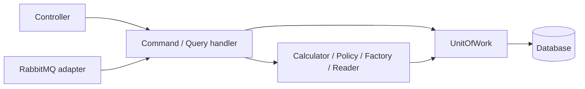

# CQRS trong GAME

Controller nhận dữ liệu HTTP, lấy danh tính đã xác thực và gửi request qua MediatR.
Command/query handler sở hữu luồng nghiệp vụ; không gọi một service bao ngoài để thực hiện lại toàn bộ use case.



## Tổ chức mã

| Nơi | Trách nhiệm |
| --- | --- |
| `GAME.Application/Features/Commands` | Điều phối thay đổi trạng thái: chiêu mộ, nâng tướng, trang bị, trận pháp, phó bản, tháp, Quick Climb, avatar. |
| `GAME.Application/Features/Queries` | Đọc danh mục, metadata, cấu hình và dữ liệu người chơi; dựng DTO trả về. |
| `GAME.Application/Features/Shared` | Helper nội bộ của từng nhóm handler: dựng projection, kiểm tra và các bước được dùng lại. Không đăng ký như service facade. |
| `GAME.Application/Services` | Thành phần dùng chung giữa nhiều use case: calculator, policy, factory, reward granter, snapshot builder, battle executor, reader và bộ điều phối transaction của tháp. |
| `GAME.Infrastructure` | EF context/mapping, repository/UOW implementation được dùng qua abstraction, cryptographic random và các adapter messaging. |
| `HRK.GAME` | Controller, xác thực HTTP, exception filter và composition root đăng ký DI. |

Các facade đã bỏ: `SummonService`, `HeroUpgradeService`, `HeroStarUpgradeService`,
`HeroEquipmentService`, `InventoryService`, `CatalogService`, `MetadataService`,
`GameFeatureConfigService`, `FormationService`, `DungeonService`, `DungeonChestService`,
`TowerClimbService`, `TowerQuickClimbService`, `BattleLabService`, `BattleService`.
Interface và đăng ký DI tương ứng cũng đã được bỏ.

## Thành phần vẫn giữ

- `IGamePlayerService` chỉ còn lookup entity player theo user/id và wallet theo player id. Các handler/helper dùng lại những lookup này.
- `IPlayerReadModels` dựng profile, game info, wallet DTO, chi tiết tướng và avatar; command trang bị/nâng tướng cũng dùng reader này khi cần trả lại chi tiết tướng.
- Các calculator về power, hero/item stats, progression, formation và level/experience vẫn là thành phần dùng chung.
- `IBattleExecutor` chuẩn bị và mô phỏng trận đấu, được cả command battle và command phó bản sử dụng. Lấy lịch sử trận đấu là query riêng.
- `IDungeonStarService` tính sao và đọc thống kê. Việc ghi tiến độ màn nằm trong `StartStageCommandHandler`.
- `IDungeonChestReader` đọc trạng thái rương; nhận thưởng nằm trong `ClaimDungeonChestCommandHandler`.
- `BattleLabPolicy` kiểm tra cấu hình thử nghiệm; catalog và chạy mô phỏng nằm trong query/command tương ứng.
- `IGameRequestContext` cung cấp danh tính cho handler. `HttpGameRequestContext` là adapter HTTP; Application không dùng `IHttpContextAccessor` hoặc kế thừa `Core.Web.CQRS` nữa.

## Đọc dữ liệu và khởi tạo

Query stamina tính hồi phục/reset lượt mua trên entity đọc detached, không gọi save.
Command mua thể lực/vào phó bản áp dụng và lưu thay đổi khi thực hiện nghiệp vụ.

Query trận pháp không tự tạo trận pháp. Query tháp đọc kỳ hiện tại và tiến độ hiện có,
hoặc dựng giá trị mặc định trong bộ nhớ khi chưa có bản ghi; không tự tạo kỳ/tiến độ hay chuyển thưởng tồn.

Để giữ các route và hành vi frontend hiện tại, controller của các màn hình này gửi
`InitializePlayerFormationsCommand` hoặc `RefreshTowerPeriodCommand` trước query tương ứng.
Refresh mặc định chỉ xử lý `TOWER_CLIMB`; màn hình danh sách/chi tiết sự kiện gửi phạm vi
tất cả sự kiện để giữ hành vi cũ. Endpoint đọc thưởng tồn chỉ gửi query.
Vì vậy một số HTTP GET vẫn có bước khởi tạo, nhưng việc ghi được thể hiện bằng command riêng.
Nếu sau này muốn HTTP GET hoàn toàn chỉ đọc, cần chuyển bước lifecycle này sang luồng
khởi tạo người chơi, endpoint command hoặc scheduler, đồng thời điều chỉnh frontend.
Query được gọi độc lập sẽ chỉ đọc, không có tác dụng khởi tạo.

## Transaction và messaging

DB access đi qua `IUnitOfWork`; command quyết định phạm vi transaction theo nghiệp vụ.
Không áp dụng transaction behavior chung cho mọi request.

- Chiêu mộ giữ transaction, khóa wallet, RowVersion và receipt theo `(PlayerId, RequestId)` để chống trừ tiền/cấp thưởng lặp.
- Tháp và Quick Climb giữ `TowerOperationRunner`, khóa theo người chơi và cơ chế retry/clear tracking.
- `ProcessQuickClimbFloorCommandHandler` giữ Inbox, thay đổi trạng thái job và Outbox trong cùng transaction; vẫn kiểm tra floor/version trước xử lý.
- RabbitMQ handler chỉ chuyển message thành command và chuyển lỗi transient của Application thành marker retry của transport.
- Helper cấp thưởng/lifecycle có thể cần save trung gian để lấy ID hoặc đọc lại dữ liệu; save không đồng nghĩa commit. Transaction bên ngoài vẫn sở hữu commit/rollback.
- `UpdatePlayerHeroFlagsCommandHandler` cập nhật lock và favorite cùng một lần save, đồng thời kiểm tra quyền sở hữu tướng.

API tiếp tục dùng `BaseResponse<T>` và các filter/exception handler hiện có. Avatar custom vẫn trả binary, ETag và cache header qua controller.

## Kiểm thử

`GameCqrsTests` kiểm tra DI của toàn bộ handler, identity adapter, quyền sở hữu tướng,
query không save và chặn campaign khỏi API battle chung.
`GameCqrsHttpTests` kiểm tra route trận pháp, envelope, business 404, file avatar và adapter RabbitMQ.
Các bài kiểm thử chiêu mộ SQL và Battle Lab gọi handler thật thay cho facade cũ.

```powershell
$env:HRK_SUMMON_SQL_TESTS='1'
dotnet test Tests/dcs-game/GAME.Domain.Tests/GAME.Domain.Tests.csproj
dotnet test Tests/Core.Modules.Tests/Core.Modules.Tests.csproj
dotnet test Tests/Oservability.Tests/Oservability.Tests.csproj
```

Các bài SQL dùng database LocalDB tạm riêng và tự dọn sau khi chạy.
