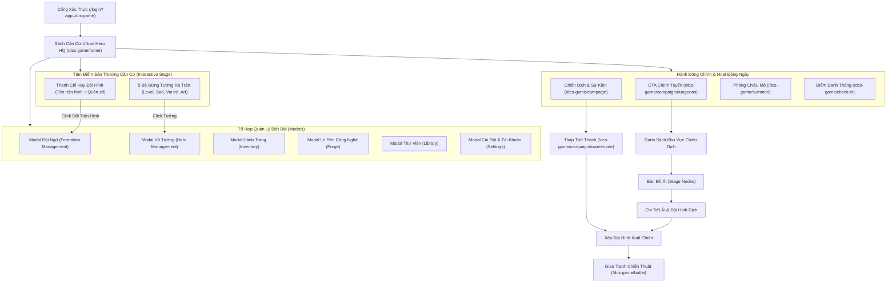

# HRK Game UX/UI Redesign — Urban Hero HQ ("Căn Cứ Biệt Đội Anh Hùng")

## 1. Visual World & Art Direction

### Concept: Urban Hero HQ — Căn Cứ Biệt Đội Anh Hùng
- **Bối cảnh thế giới**: Sân thượng điều hành chiến thuật của Biệt Đội Anh Hùng nhìn ra đường chân trời đô thị hiện đại vào thời khắc **Blue Hour / Chập tối**.
- **Ngôn ngữ kiến trúc**: Kết cấu thép graphite/navy (`#10151B` → `#19212A` → `#222D38`), đường dẫn năng lượng cyan (`#38BDF8`) và lime (`#BCF27B`) tiết chế, kết hợp ánh đèn vàng ấm (`#F59E0B`) từ các tòa nhà cao tầng phía xa tạo chiều sâu không gian và sự sống động.
- **Bảo toàn bản sắc nhân vật HRK**: Giữ trọn vẹn nét hài hước, học viện và meme đặc trưng của dàn nhân vật HRK (`Hoàng Nguyên Gymer`, `Nghĩa Phúc Prime`, `Quốc Nhân Chạy Ngay Đi`, `Siba Thiên Thần`, `Kiệt Bác Sĩ`, `Ricardo Milos`, v.v.) trên nền tảng công nghệ đô thị sắc nét.

---

## 2. Environment Art Assets & Prompts

Bốn bức tranh môi trường 16:9 (`1344×768`, PNG tối ưu) đã được thiết kế mới và tích hợp trực tiếp vào hệ thống asset của game (`HrkUi/src/assets/images/dcs-game/backgrounds/`):

| Asset File | Màn hình sử dụng | Mô tả & Prompt Concept |
| :--- | :--- | :--- |
| `urban-hq-home.png` & `lobby-bg.png` | **Home / Sảnh Căn Cứ (`GameHomeComponent`)** & **Cổng Xác Thực (`GameAuthComponent`)** & **Điểm Danh (`CheckInPageComponent`)** | *Wide 16:9 2D anime/game environment illustration of an Urban Hero Headquarters rooftop command deck at twilight blue hour overlooking a modern Asian metropolis skyline; graphite/navy structural beams, subtle cyan and lime tactical floor markings, circular central helipad stage for 5 squad heroes, warm amber skyscraper windows in the distance, no text or UI.* |
| `summon-chamber-bg.png` | **Phòng Chiêu Mộ (`SummonPageComponent`)** | *Wide 16:9 2D game environment illustration of an indoor Urban Hero HQ high-tech recruitment & teleportation chamber; dark graphite architectural pillars, glowing cyan (`#38BDF8`) and lime (`#BCF27B`) concentric arrival energy rings on the floor, clean central focal stage for recruitment capsules.* |
| `campaign-district-bg.png` | **Chiến Dịch, Sự Kiện & Bản Đồ Khu Vực (`CampaignEventListComponent`, `CampaignMapListComponent`)** | *Wide 16:9 elevated tactical bird's-eye view of a modern coastal metropolis at twilight blue hour; distinct urban districts connected by glowing cyan transit viaducts, suspension bridges, and illuminated highways for stage progression.* |
| `tower-hq-bg.png` | **Tháp Thử Thách (`TowerClimbComponent`)** & **Event Banner** | *Wide 16:9 dramatic low-angle illustration of a monumental graphite-and-glass skyscraper spire ascending through evening storm clouds; vertical cyan and lime energy conduits running up the tower core.* |

- Tất cả alias trong `HrkUi/src/assets/catalog/asset-paths.json` (bao gồm `images/dcs-game/lobby_bg.png` và `images/dcs-game/events/tower-banner.png`) đã được đồng bộ qua `node scripts/prepare-assets.mjs` và kiểm tra bằng `npm run assets:check`.

---

## 3. Sitemap, Navigation Architecture & Player Journeys

### Quy tắc Điều hướng & Chống Nhiễu Thị Giác
1. **Loại bỏ thành phần giả / chết**: Đã gỡ bỏ nhãn `18+` tĩnh và nút Chat giả không có chức năng ở cạnh trái màn hình Home; gỡ bỏ chấm đỏ giả cố định trên nút `THÊM`.
2. **Badge thông báo trung thực**: Chỉ hiển thị `.notification-badge` khi `item.hasNotification === true` từ dữ liệu cấu hình thực tế.
3. **Tương tác trực tiếp trên Sân Thượng Căn Cứ**:
   - Click vào bất kỳ tướng nào trên sân khấu mở ngay **Quản Lý Võ Tướng (`HeroManagementComponent`)**.
   - Click vào thanh chỉ huy trận hình phía trên sân khấu mở ngay **Đội Ngũ (`FormationManagementComponent`)**.
   - Dữ liệu đội hình trên sân khấu tự động đồng bộ từ `FormationService.getFormationDetail(selectedFormationCode)` mỗi khi người chơi vào Home hoặc đóng modal Võ Tướng / Đội Ngũ.

---

## 4. Chi Tiết Thiết Kế Lại Từng Màn Hình

### A. Sảnh Căn Cứ (`GameHomeComponent`)
- **Top-Left Command HUD**: Khung avatar bo góc sắc nét có viền lime (`#BCF27B`), badge cấp độ, tên người chơi, nút Cài đặt (`bi-gear-fill`), chỉ số Chiến Lực (`C.Lực`) hiển thị bằng font monospace, thanh tiến trình EXP và các nút chức năng phụ (`Đồng bộ template`, `Nạp`, `Thành tựu`).
- **Top-Right Resource & Event Rail**: Cụm tài nguyên Thể lực (`Stamina`), Vàng (`Gold`), Kim cương (`Diamond`) dạng pill gọn gàng kèm nút `+` thao tác nhanh; phía dưới là thanh sự kiện động (`topEvents`).
- **Center Urban HQ Rooftop Stage**:
  - Thanh chỉ huy đội hình (`.squad-command-bar`) hiển thị tên trận hình đang kích hoạt (`selectedFormationName`), số lượng tướng (`5/5`) và 2 nút thao tác nhanh (`Võ Tướng`, `Đội Ngũ`).
  - 5 bệ đứng chiến thuật (`.hero-showcase`) với vòng sáng năng lượng (`.pedestal-ring`), thẻ cấp độ + tên tướng, dải sao (`.hero-stars-row`), chân dung nhân vật thực tế từ `/assets/images/dcs-game/heroes/*.png`, và nhãn vai trò.
- **Bottom Command Dock**:
  - Bên trái: Cụm điều hướng quản lý căn cứ (`bottomFeaturesLeft`).
  - Bên phải: Cụm tác chiến (`bottomFeaturesRight`, nút `Đấu Trường`, và nút CTA nổi bật `Chính Tuyến`).

### B. Quản Lý Võ Tướng (`HeroManagementComponent`) & Đội Ngũ (`FormationManagementComponent`)
- **Hero Management**: Bố cục 3 cột trên Desktop (Roster List có tìm kiếm/lọc/sắp xếp → Sân khấu tướng & 6 ô trang bị → Panel chi tiết Kỹ năng / Nâng cấp / Nâng sao / Nguồn chỉ số) và chuyển đổi mượt sang chế độ Master-Detail kết hợp Bottom-Sheet trên Mobile.
- **Formation Management**: Bàn cờ chiến thuật Tiền Quân / Hậu Quân hỗ trợ cả kéo-thả (Drag & Drop) lẫn chạm-để-gán (Tap-to-assign) trên thiết bị di động, hiển thị rõ cộng hưởng trận pháp và chi phí nâng cấp trận đồ.

### C. Hành Trang (`InventoryComponent`) & Lò Rèn (`ForgeComponent`)
- **Inventory**: Phân loại tab rõ ràng (`Tất cả`, `Trang bị`, `Tiêu hao`, `Nguyên liệu`, `Mảnh`), thanh dung lượng kho đồ, ô vật phẩm chuẩn hóa viền độ hiếm + nhãn `+N` + trạng thái khóa/đang mặc, cùng panel so sánh chỉ số trực quan.
- **Forge**: Bàn chế tác nâng cấp trang bị đặt trên nền công nghệ đô thị, hiển thị tỷ lệ thành công, nguyên liệu yêu cầu, chi phí Vàng và hiệu ứng phản hồi kết quả nâng cấp.

### D. Phòng Chiêu Mộ (`SummonPageComponent`)
- Đặt trong không gian `summon-chamber-bg.png` với 2 cổng chiêu mộ **Thường (Vàng)** và **Cao Cấp (Kim Cương)**.
- Hiển thị rõ số dư ví so với chi phí mở `1 Lần` / `10 Lần`, bảng tỷ lệ độ hiếm minh bạch, vòng quay đơn (`SummonReelComponent`) có nút **Bỏ qua** tức thì, và bảng kết quả 10 lần (`SummonResultModalComponent`) tôn vinh thẻ tướng hiếm.

### E. Điểm Danh Tháng (`CheckInPageComponent`)
- Nền `urban-hq-home.png` kết hợp bảng lịch 7 cột chuẩn thứ trong tuần (`T2` → `CN`).
- Làm nổi bật ô **Hôm nay (`CLAIMABLE`)** với viền lime phát sáng, đồng hồ đếm ngược đến giờ reset server, và hộp xác nhận phần thưởng sau khi nhận.

### F. Chiến Dịch, Bản Đồ Ải & Tháp Thử Thách (`Campaign*`, `TowerClimbComponent`)
- **Chiến dịch & Khu vực**: Nền `campaign-district-bg.png` tạo cảm giác bản đồ tác chiến đô thị; thẻ khu vực hiển thị rõ tiến độ sao và phần thưởng.
- **Tháp Thử Thách**: Nền `tower-hq-bg.png` kết hợp cột hiển thị tướng đại diện bên trái, thông số tầng/mạng/lượt leo nhanh và sơ đồ các tầng tháp bên phải.

### G. Giao Tranh Chiến Thuật (`BattlePageComponent`)
- HUD chiến đấu gọn gàng: thanh máu/năng lượng rõ ràng, cụm điều khiển tốc độ (`x1`/`x2`), `Auto`, `Skip`, nhật ký giao tranh có thể thu gọn và modal tổng kết Thắng/Thua đồng bộ design system.

