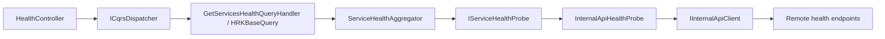

# Health check và API tổng hợp Admin

`CoreEngine/Core.HealthChecks` là thư viện dùng chung, target .NET 9, có thể đóng
gói NuGet. Thư viện phụ trách đăng ký check, timeout, endpoint và hợp đồng JSON.
Các class kiểm tra dependency nằm tại **`HealthChecks/Dependencies` trong từng
project service**; thư viện không tham chiếu EF, Redis hoặc RabbitMQ.

## Endpoint tại từng service

| Endpoint | Nội dung | HTTP |
| --- | --- | --- |
| `GET /health/live` | Check `self`, không truy cập dependency | 200 |
| `GET /health/dependencies` | Các dependency đã đăng ký và bật | 200 Healthy / 503 Unhealthy |
| `GET /health`, `GET /health/ready` | Alias của dependency để giữ đường dẫn cũ | 200 / 503 |

Endpoint health cho phép gọi nội bộ không cần JWT. Response không được cache;
chỉ có tên service/instance, thời điểm UTC, trạng thái, thời gian và mã lỗi.
Không đưa exception, connection string hoặc `Data` tùy ý của check ra JSON.
Trạng thái .NET `Degraded` cũng được quy về `Unhealthy`.

| Service | Dependency custom |
| --- | --- |
| AUTH | Database qua `IUnitOfWork`, Redis localization khi localization bật |
| GAME | Database qua `IUnitOfWork`, RabbitMQ, Redis game, Redis localization khi bật |
| REALTIME | RabbitMQ, Redis khi `Redis:Enabled=true` |
| ACTIVITY | Database qua `IUnitOfWork`, RabbitMQ |
| LANGUAGE | Database qua `IUnitOfWork`, Redis bundle |
| Gateway | Liveness của AUTH, GAME, LANGUAGE, ADMIN |
| ADMIN | Chưa có dependency riêng; thư mục chứa README cho các class bổ sung sau |

Redis probe dùng `IRedisConnectionProvider` chung và `PingAsync`; RabbitMQ dùng
`IRabbitMqConnection` chung và `IsOpen`. Không mở kết nối mới cho mỗi request,
không ghi dữ liệu thử hoặc thay đổi topology. Gateway lấy danh sách HTTP check từ
`GatewayHealthChecks:Dependencies` và địa chỉ/policy từ `InternalApi:Services`.
Mặc định gọi `/health/live` để tránh vòng lặp với API tổng hợp Admin.

### Cấu hình dependency HTTP của Gateway

```json
{
  "GatewayHealthChecks": {
    "Dependencies": {
      "service.auth": {
        "ServiceName": "health-auth",
        "ExpectedService": "HRK.AUTH",
        "Path": "/health/live"
      }
    }
  },
  "InternalApi": {
    "Services": {
      "health-auth": {
        "BaseAddress": "http://hrk.auth:8080",
        "TimeoutSeconds": 1.5,
        "Retry": { "Enabled": false, "MaxRetries": 0 },
        "CircuitBreaker": { "Enabled": false }
      }
    }
  },
  "HealthChecks": {
    "Dependencies": {
      "service.auth": { "Enabled": true, "TimeoutSeconds": 2 }
    }
  }
}
```

`service.auth` là tên component trong JSON; `ServiceName` trỏ đến cấu hình HTTP
client; `ExpectedService` xác nhận identity trong report; `Path` là đường dẫn
liveness của service đích. Các target dùng chung custom class
`HealthChecks/Dependencies/DownstreamServiceHealthCheck.cs`, được tạo qua factory
trong scope riêng. Thêm một target HTTP chỉ cần bổ sung config, không tạo class
mới. Config được đọc khi khởi động, cần restart Gateway sau khi thay đổi.

Địa chỉ local nằm trong `ApiGateway/ApiGateway/appsettings.json`. Compose ghi đè
`InternalApi__Services__health-auth__BaseAddress` và các client tương ứng bằng
hostname Docker. Địa chỉ health được quản lý độc lập với route Ocelot; khi đổi
địa chỉ triển khai cần cập nhật config tương ứng. HTTP timeout/policy lấy nguyên
từ `InternalApi`, không bị code ghi đè. Timeout của toàn check vẫn do `HealthChecks`
quản lý. Mặc định retry và circuit breaker tắt để mỗi probe đo một request mới.

## Thêm custom check

Ví dụ tạo `HealthChecks/Dependencies/GameDatabaseHealthCheck.cs`:

```csharp
using Core.HealthChecks;
using Core.Persistence.Repositories;

public sealed class GameDatabaseHealthCheck(IUnitOfWork unitOfWork)
    : DependencyHealthCheck("DatabaseUnavailable")
{
    protected override Task<bool> IsAvailableAsync(CancellationToken ct) =>
        unitOfWork.CanConnectAsync(ct);
}
```

Trong hàm đăng ký dependency của service:

```csharp
services.AddHrkHealthChecks("HRK.GAME", configuration)
    .AddDependency<GameDatabaseHealthCheck>("database");
// Program.cs
app.MapHrkHealthChecks();
```

Có thể implement `IHealthCheck` trực tiếp. Mỗi check được resolve trong scope
riêng của ASP.NET Core, phù hợp với UOW/DbContext scoped. Check phải tôn trọng
`CancellationToken`; API vendor không nhận token thì dùng `WaitAsync(ct)` khi chờ.

```json
{
  "HealthChecks": {
    "DefaultTimeoutSeconds": 2,
    "Dependencies": {
      "database": { "Enabled": true, "TimeoutSeconds": 3 },
      "redis.localization": { "Enabled": false }
    }
  }
}
```

Tên class và DI được khai báo trong code; config điều chỉnh bật/tắt và timeout
theo tên check. Config được đọc khi khởi động. Check bị tắt không có trong báo cáo.
Nếu không có dependency được bật, báo cáo dependency trả Healthy với `checks: []`.
`CanConnectAsync`, Redis ping và RabbitMQ IsOpen chỉ chứng minh kết nối khả dụng;
chúng không xác nhận schema, quyền ghi, tiến độ consumer/outbox hoặc nghiệp vụ.

## Admin Service

- Gọi trực tiếp: `GET http://localhost:5006/api/admin/health/services`.
- Qua Gateway: `GET http://localhost:5000/gateway/admin/health/services`.
- Header: `Authorization: Bearer <access-token>` có role **`Admin`**.
- Mặc định kiểm tra issuer `hrkapp`, audience `game-api` để dùng access token quản
  trị hiện có của GAME. Có thể thay `JwtSettings:Issuer`/`Audience` theo triển khai.
  `JwtSettings:SecretKey` phải cùng signing key của AUTH, cấp qua biến môi trường;
  appsettings của Admin không chứa secret mặc định.
- Chưa xác thực trả 401, thiếu role trả 403. API tổng hợp trả **HTTP 200 khi tạo
  được báo cáo**, kể cả một số service Unhealthy. Response dùng `BaseResponse`:
  `success: true`, báo cáo nằm trong `data`; đọc `data.status` và `data.services`.

Admin được tổ chức thành ba project:

| Project | Trách nhiệm |
| --- | --- |
| `HRK.ADMIN` | Controller, JWT/policy, API filters, composition root và health của chính Admin |
| `Admin.Application` | Query/handler, DTO/options, interface và điều phối `ServiceHealthAggregator` |
| `Admin.Infrastructure` | `InternalApiHealthProbe` gọi HTTP, kiểm tra remote report và cấu hình transport |



`Program.cs` gọi `MapControllers()`; endpoint quản trị được khai báo tại
`Controllers/HealthController.cs`. Controller gửi query qua `ICqrsDispatcher` của
`Core.Application`; dispatcher giữ MediatR/validation pipeline bên trong CoreEngine.
Handler kế thừa `HRKBaseQuery` generic của `Core.Web.CQRS`, gọi
`IServiceHealthAggregator` và tạo `BaseResponse<SystemHealthReport>`. Host đăng ký
`IHttpContextAccessor` cho HRK base. Aggregator điều phối qua `IServiceHealthProbe`;
Infrastructure thực hiện HTTP.

`ServiceHealthAggregator` giữ deadline chung, semaphore, thứ tự liveness/dependency
và kết quả từng target. `InternalApiHealthProbe` xử lý HTTP timeout/status, xác nhận
identity/kind/contract và chuyển lỗi kết nối thành `EndpointHealth`. Cancellation
được truyền từ controller qua query, aggregator đến HTTP client.

Các endpoint `/health/live`, `/health/dependencies` vẫn trả `ServiceHealthReport`
trực tiếp; chúng không chạy aggregator. Hướng dẫn tạo service mới:
[new-service-guide.md](new-service-guide.md).

Admin gọi trực tiếp hai endpoint health của mỗi target bằng `IInternalApiClient`.
`GetResponseAsync<T>` nhận cả HTTP 200 và 503 để không mất body của dependency lỗi.
Retry và circuit breaker của các HTTP client theo dõi bị tắt, tránh trả trạng thái
do các lần gọi trước. Mặc định tối đa 4 target đồng thời, timeout mỗi probe 4 giây,
deadline cả báo cáo 10 giây. Các check dependency phía service mặc định 2 giây.

Liveness không trả được report hợp lệ thì `dependencies: null`, service Unhealthy
và có `errorCode` như `Unavailable`, `Timeout`, `HttpError`, `InvalidResponse`.
Không suy diễn trạng thái DB/Redis khi không gọi được service. Các kết quả đã hoàn
tất được giữ lại nếu target khác hết thời gian. Client hủy request sẽ hủy probe.

Ví dụ phần `data` của response:

```json
{
  "status": "Unhealthy",
  "checkedAtUtc": "2026-10-28T12:00:00Z",
  "durationMs": 83,
  "services": [{
    "target": "game",
    "service": "HRK.GAME",
    "status": "Unhealthy",
    "liveness": {
      "status": "Healthy",
      "httpStatusCode": 200,
      "durationMs": 5,
      "report": {
        "contractVersion": 1, "service": "HRK.GAME", "instanceId": "game-1",
        "kind": "liveness", "status": "Healthy",
        "checkedAtUtc": "2026-10-28T12:00:00Z", "durationMs": 1,
        "checks": [{ "name": "self", "status": "Healthy", "durationMs": 0.1 }]
      }
    },
    "dependencies": {
      "status": "Unhealthy",
      "httpStatusCode": 503,
      "durationMs": 78,
      "report": {
        "contractVersion": 1, "service": "HRK.GAME", "instanceId": "game-1",
        "kind": "dependency", "status": "Unhealthy",
        "checkedAtUtc": "2026-10-28T12:00:00Z", "durationMs": 75,
        "checks": [
          { "name": "database", "status": "Unhealthy", "durationMs": 75, "errorCode": "DatabaseUnavailable" },
          { "name": "rabbitmq", "status": "Healthy", "durationMs": 2 }
        ]
      }
    }
  }]
}
```

Danh sách target nằm trong `HealthMonitoring:Services` của Admin, mỗi target trỏ
đến một key trong `InternalApi:Services` (địa chỉ chỉ khai báo tại đây):

```json
{
  "HealthMonitoring": {
    "RequestTimeoutSeconds": 10,
    "ProbeTimeoutSeconds": 4,
    "MaxConcurrency": 4,
    "Services": [{ "ServiceName": "game", "ExpectedService": "HRK.GAME", "Enabled": true }]
  },
  "InternalApi": {
    "Services": {
      "game": {
        "BaseAddress": "http://hrk.game:8080",
        "Retry": { "Enabled": false, "MaxRetries": 0 },
        "CircuitBreaker": { "Enabled": false }
      }
    }
  }
}
```

Đây là danh sách cấu hình, không tự dò process/container. Target đã bật nhưng đang
tắt vẫn có trong JSON và được báo Unhealthy. Mặc định có Gateway, AUTH, GAME,
REALTIME, ACTIVITY, LANGUAGE. Trong Compose hiện tại ACTIVITY nằm ở file observability;
nếu không chạy ACTIVITY thì có thể tắt target bằng
`HealthMonitoring__Services__4__Enabled=false`. Một URL sau load balancer chỉ kiểm
tra instance nhận request; muốn xem từng instance thì khai báo target riêng với
địa chỉ trực tiếp, ví dụ `game-1`, `game-2`, cùng `ExpectedService: HRK.GAME`.

Admin khởi động độc lập, không `depends_on: service_healthy` của các target.
Không cần database, SQL script hoặc migration mới cho tính năng này.

## Chạy và kiểm tra

Cấu hình `.env` như dự án hiện tại, đặc biệt `JWT_SECRET_KEY` cùng key của AUTH/GAME.

```powershell
docker compose up -d --build
# Có cả ACTIVITY và hệ thống quan sát:
docker compose -f docker-compose.yml -f docker-compose.observability.yml up -d --build

Invoke-RestMethod http://localhost:5002/health/live
Invoke-RestMethod http://localhost:5000/gateway/admin/health/services `
  -Headers @{ Authorization = "Bearer $accessToken" }

dotnet test Tests/HealthChecks.Tests/HealthChecks.Tests.csproj
dotnet pack CoreEngine/Core.HealthChecks/Core.HealthChecks.csproj -c Release -o .tmp/health-pack
```

Để chạy Admin riêng ngoài Docker, đặt biến `JwtSettings__SecretKey`, kiểm tra lại
địa chỉ `InternalApi:Services` theo port đang chạy, rồi:

```powershell
dotnet run --project Services/HRKADMIN/HRK.ADMIN/HRK.ADMIN.csproj --launch-profile http
```

Nếu chạy AUTH/GAME bằng profile Visual Studio/IIS thay vì Docker, đổi địa chỉ probe
Admin và `InternalApi:Services` của Gateway tương ứng.
