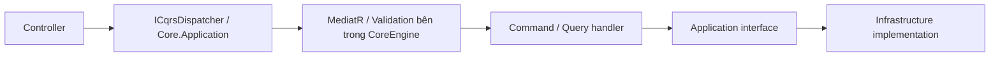

# Hướng dẫn tạo service mới trong HRK

Tài liệu này dùng cấu trúc Admin hiện tại làm mẫu để tạo service .NET 9 mới.
Ví dụ tên service là `HRK.EXAMPLE`, thư mục `Services/HRKEXAMPLE`, Docker hostname
`hrk.example`, port local `5007`, audience dự kiến `example-api`.
Thay các tên này theo service thực tế và kiểm tra port còn trống.

## 1. Chọn cấu trúc và chiều phụ thuộc

```text
Services/HRKEXAMPLE/
  HRK.EXAMPLE/                         API host
    Controllers/
    Configuration/DependencyInjection.cs
    HealthChecks/Dependencies/        Custom health check của service
    Properties/launchSettings.json
    appsettings.json
    appsettings.Development.json
    Dockerfile
    Program.cs
  Example.Application/                Use case
    Features/Commands/<Feature>/
    Features/Queries/<Feature>/
    DTOs/
    Interfaces/
    Configuration/
    DependencyInjection/
  Example.Infrastructure/             Implementation I/O
    DependencyInjection/
    Services/
    Data/                             Khi có database
```

- API tham chiếu Application và Infrastructure để ghép DI.
- Infrastructure tham chiếu Application và triển khai các interface do Application định nghĩa.
- Application dùng `Core.Application`/`Core.Common`; không tham chiếu API hoặc Infrastructure.
- Mỗi class, record, interface và options nằm trong file riêng, tên file theo tên type.
- Chỉ tạo folder/module khi có nội dung sử dụng.

Khi có entity, value object và quy tắc nghiệp vụ riêng, thêm `Example.Domain`.
Application/Infrastructure được tham chiếu Domain; Domain giữ độc lập với HTTP,
EF và DI. GAME hiện có Domain nên tổng cộng bốn project; Admin hiện dùng ba project.

Các mẫu đang chạy:

- [Host DI của Admin](../Services/HRKADMIN/HRK.ADMIN/Configuration/DependencyInjection.cs).
- [Application DI](../Services/HRKADMIN/Admin.Application/DependencyInjection/AdminApplicationServiceCollectionExtensions.cs).
- [Infrastructure DI](../Services/HRKADMIN/Admin.Infrastructure/DependencyInjection/AdminInfrastructureServiceCollectionExtensions.cs).
- [Controller](../Services/HRKADMIN/HRK.ADMIN/Controllers/HealthController.cs),
  [query](../Services/HRKADMIN/Admin.Application/Features/Queries/HealthMonitoring/GetServicesHealthQuery.cs),
  [handler](../Services/HRKADMIN/Admin.Application/Features/Queries/HealthMonitoring/GetServicesHealthQueryHandler.cs).

## 2. Tạo project và thêm vào solution

Các lệnh scaffold dưới đây dùng SDK .NET 9 hỗ trợ template `net9.0`. Kiểm tra
`dotnet --version` và `dotnet --list-sdks`; nếu máy chọn SDK khác, chọn SDK 9 đã cài
cho workspace trước khi chạy template. Có thể tạo các csproj dựa trên Admin thay
cho scaffold; giữ `TargetFramework=net9.0`, nullable và implicit usings bật.

Chạy từ thư mục gốc HRK:

```powershell
dotnet new webapi -n HRK.EXAMPLE -o Services/HRKEXAMPLE/HRK.EXAMPLE -f net9.0 --use-controllers --no-restore
dotnet new classlib -n Example.Application -o Services/HRKEXAMPLE/Example.Application -f net9.0 --no-restore
dotnet new classlib -n Example.Infrastructure -o Services/HRKEXAMPLE/Example.Infrastructure -f net9.0 --no-restore

dotnet sln HRK.sln add Services/HRKEXAMPLE/HRK.EXAMPLE/HRK.EXAMPLE.csproj --solution-folder Services/HRKEXAMPLE
dotnet sln HRK.sln add Services/HRKEXAMPLE/Example.Application/Example.Application.csproj --solution-folder Services/HRKEXAMPLE
dotnet sln HRK.sln add Services/HRKEXAMPLE/Example.Infrastructure/Example.Infrastructure.csproj --solution-folder Services/HRKEXAMPLE
```

Xóa `Class1`, WeatherForecast và endpoint mẫu sau scaffold. Điều chỉnh package
OpenAPI do template tạo để khớp cách dùng Swagger của host. Admin dùng
`Swashbuckle.AspNetCore.SwaggerGen` và `SwaggerUI` phiên bản `9.0.3`,
`Microsoft.AspNetCore.Authentication.JwtBearer` phiên bản `9.0.9`.

Thêm các reference cơ bản:

```powershell
dotnet add Services/HRKEXAMPLE/HRK.EXAMPLE/HRK.EXAMPLE.csproj reference Services/HRKEXAMPLE/Example.Application/Example.Application.csproj Services/HRKEXAMPLE/Example.Infrastructure/Example.Infrastructure.csproj CoreEngine/Core.Web/Core.Web.csproj CoreEngine/Core.HealthChecks/Core.HealthChecks.csproj CoreEngine/Oservability/Oservability.csproj
dotnet add Services/HRKEXAMPLE/Example.Application/Example.Application.csproj reference CoreEngine/Core.Application/Core.Application.csproj
dotnet add Services/HRKEXAMPLE/Example.Application/Example.Application.csproj reference CoreEngine/Core.Web/Core.Web.csproj
dotnet add Services/HRKEXAMPLE/Example.Infrastructure/Example.Infrastructure.csproj reference Services/HRKEXAMPLE/Example.Application/Example.Application.csproj
```

Thư viện ngoài được thêm vào project thật sự sử dụng nó. Ví dụ adapter HTTP nằm
ở Infrastructure thì project đó tham chiếu `Core.InternalApi` và `Oservability`
nếu dùng `AddHrkInternalApi`. DTO health dùng chung như Admin thì Application
có thể tham chiếu contract trong `Core.HealthChecks`.

Reference `Core.Web` trong Application phục vụ `HRKBaseCommand`/`HRKBaseQuery`
HTTP-aware theo mẫu Admin: base cung cấp user/session, IP và response helper.
Host đăng ký `AddHttpContextAccessor`; unit test resolve handler cũng đăng ký
accessor. `Core.Application` cung cấp dispatcher và contract CQRS độc lập với
HttpContext; các handler nền thuần nghiệp vụ có thể dùng interface handler trực tiếp.

## 3. Tổ chức DI và Program.cs

Trong host, tạo `AddCustomDependency()` gọi observability rồi `AddServices()`.
Tách các hàm theo nhiệm vụ, theo mẫu Admin:

```text
AddCustomDependency(builder)
  AddHrkObservability("HRK.EXAMPLE")
  AddServices(services, configuration)
    AddApiServices(...)
    AddSecurityServices(...)
    AddApplicationServices(...)
    AddInfrastructureServices(...)
    AddServiceHealthChecks(...)
```

`AddApiServices` đăng ký:

```csharp
services.AddHttpContextAccessor();
services.AddControllers(options => options.AddHrkApiFilters());
services.AddHrkApiResponses();
services.AddSwaggerGen();
```

Các extension API dùng namespace `Core.Web.Filters` và `Core.Web.Responses`.
Khi host/test/module cần controller discovery tường minh, thêm
`.AddApplicationPart(typeof(SomeController).Assembly)` sau `AddControllers`.

Trong Application, tạo extension `AddExampleApplication(...)` và gọi một lần:

```csharp
services.AddCoreApplication(typeof(GetServiceInfoQuery).Assembly);
```

Extension thuộc `Core.Application.DependencyInjection`, đăng ký `ICqrsDispatcher`,
MediatR nội bộ, scan validator và validation pipeline. Controller sử dụng dispatcher
qua `Core.Application.CQRS`, không cần inject `IMediator`/`ISender` trực tiếp.
Infrastructure có `AddExampleInfrastructure(...)`
để đăng ký adapter, persistence và các module I/O thực sự sử dụng.

`Program.cs` làm nhiệm vụ ghép pipeline:

```csharp
using Core.HealthChecks;
using Core.Web.Responses;
using HRK.EXAMPLE.Configuration;
using Oservability;

var builder = WebApplication.CreateBuilder(args);
builder.AddCustomDependency();
var app = builder.Build();
app.UseHrkCorrelation();
app.UseHrkApiResponses();
if (app.Environment.IsDevelopment())
{
    app.UseSwagger();
    app.UseSwaggerUI();
}
app.UseRouting();
app.UseAuthentication();
app.UseHrkIdentityLogging();
app.UseAuthorization();
app.MapControllers();
app.MapHrkHealthChecks();
app.Run();

public partial class Program;
```

## 4. Controller và CQRS

Luồng chuẩn:



Ví dụ query đọc thông tin service; mỗi đoạn đặt vào file riêng theo tên type:

```csharp
// DTOs/ServiceInfoDto.cs
namespace Example.Application.DTOs;

public sealed record ServiceInfoDto(string Name);
```

```csharp
// Features/Queries/ServiceInfo/GetServiceInfoQuery.cs
using Core.Application.CQRS;
using Core.Common.Entity.MyCompany.Shared.Responses;
using Example.Application.DTOs;

namespace Example.Application.Features.Queries.ServiceInfo;

public sealed record GetServiceInfoQuery : IQuery<BaseResponse<ServiceInfoDto>>;
```

```csharp
// Features/Queries/ServiceInfo/GetServiceInfoQueryHandler.cs
using Core.Web.CQRS;
using Microsoft.AspNetCore.Http;
using Core.Common.Entity.MyCompany.Shared.Responses;
using Example.Application.DTOs;

namespace Example.Application.Features.Queries.ServiceInfo;

public sealed class GetServiceInfoQueryHandler(IHttpContextAccessor httpContextAccessor)
    : HRKBaseQuery<GetServiceInfoQuery, BaseResponse<ServiceInfoDto>>(httpContextAccessor)
{
    public override Task<BaseResponse<ServiceInfoDto>> Handle(GetServiceInfoQuery request, CancellationToken ct) =>
        Task.FromResult(BaseResponse<ServiceInfoDto>.SuccessResponse(new("HRK.EXAMPLE")));
}
```

```csharp
// Controllers/ServiceInfoController.cs
using Core.Common.Entity.MyCompany.Shared.Responses;
using Example.Application.DTOs;
using Example.Application.Features.Queries.ServiceInfo;
using Core.Application.CQRS;
using Microsoft.AspNetCore.Authorization;
using Microsoft.AspNetCore.Mvc;

namespace HRK.EXAMPLE.Controllers;

[ApiController]
[Authorize(Policy = "ExampleAdmin")]
[Route("api/example")]
public sealed class ServiceInfoController(ICqrsDispatcher dispatcher) : ControllerBase
{
    [HttpGet("info")]
    public async Task<ActionResult<BaseResponse<ServiceInfoDto>>> Get(CancellationToken ct) =>
        Ok(await dispatcher.QueryAsync(new GetServiceInfoQuery(), ct));
}
```

Đăng ký policy `ExampleAdmin` tại bước xác thực bên dưới. Thao tác ghi dùng
`ICommand<TResponse>`, handler kế thừa `HRKBaseCommand<TCommand, TResponse>` và
controller gọi `dispatcher.CommandAsync(command, ct)`. Base generic triển khai
`ICommandHandler`/`IQueryHandler` của Core.Application và dùng lại HRK base cũ;
chỉ cần override `Handle`, các helper `GetUserId()`, `GetCurrentLoginSession()` và
`Response(...)` có sẵn. Validator dùng `HRKValidator<TRequest>` khi có input cần kiểm tra.
Controller nhận HTTP, danh tính đã xác thực và truyền cancellation token; handler
sở hữu use case. Thành phần dùng lại như aggregator/calculator/policy có thể tách
riêng khi có trách nhiệm cụ thể. Interface ở Application, implementation I/O ở
Infrastructure. Không tham chiếu project GAME/ADMIN host để tái sử dụng controller
base hoặc inject DbContext trực tiếp vào controller.

Mỗi service sở hữu dữ liệu của mình. Ví dụ feature quản trị GAME từ Admin nên
gọi API của GAME qua adapter Infrastructure; không dùng trực tiếp `GameDbContext`
hoặc ghi vào bảng GAME từ Admin.

API thông thường trả `BaseResponse<T>` gồm `traceId`, `success`, `statusCode`,
`data`, `error`. Business error dùng `BusinessException`/`RequestValidationException`
của `Core.Common`; filters/middleware tạo response chung. Xem
[api-responses.md](api-responses.md) và [game-cqrs.md](game-cqrs.md).

## 5. JWT, cấu hình môi trường và địa chỉ local

Tham khảo `AddSecurityServices` của Admin để cấu hình JwtBearer xác thực issuer,
audience, signing key và thời hạn token; đăng ký authorization policy cho controller.
Ví dụ `ExampleAdmin` yêu cầu authenticated user có role `Admin`.

```json
{
  "JwtSettings": {
    "Issuer": "hrkapp",
    "Audience": "example-api",
    "SecretKey": ""
  },
  "HealthChecks": { "DefaultTimeoutSeconds": 2, "Dependencies": {} },
  "InternalApi": { "Services": {} },
  "Telemetry": { "Otlp": { "Enabled": false } },
  "Seq": { "ServerUrl": "" }
}
```

Cấp secret qua `JwtSettings__SecretKey`, cùng signing key với AUTH. Đặt port `5007`
trong `Properties/launchSettings.json` và cấu hình `ASPNETCORE_ENVIRONMENT=Development`
cho profile local. Các connection string/password đi qua biến môi trường, user
secrets hoặc `.env` local; `.env.example` lưu tên biến và giá trị minh họa.

Nếu tạo audience mới, cập nhật cấu hình ứng dụng được phép cấp token trong AUTH
(`HRK_ApplicationRouteConfig`, xem
[ApplicationRouteConfigService](../Services/AUTH/AUTH.Infrastructure/Services/ApplicationRouteConfigService.cs))
và danh sách `JwtSettings:Audiences` của Gateway tại các môi trường đang dùng.
Gateway và service đích đều xác thực token; policy/role vẫn được kiểm tra ở service.

## 6. Health check riêng cho service

Đăng ký identity đúng tên service:

```csharp
services.AddHrkHealthChecks("HRK.EXAMPLE", configuration);
```

Mỗi dependency thật sự được sử dụng có custom class riêng dưới
`HRK.EXAMPLE/HealthChecks/Dependencies`, implement `IHealthCheck` hoặc kế thừa
`DependencyHealthCheck`. Đăng ký bằng `.AddDependency<TCheck>("database")` hoặc
factory có config. Kiểm tra kết nối DB dùng `IUnitOfWork.CanConnectAsync(ct)`;
Redis dùng `IRedisConnectionProvider`; RabbitMQ dùng `IRabbitMqConnection`.
Check nhận và tôn trọng cancellation token, dùng connection provider dùng chung.

`MapHrkHealthChecks()` cung cấp:

| Endpoint | Ý nghĩa |
| --- | --- |
| `/health/live` | Check self, độc lập với dependency |
| `/health/dependencies` | Các check dependency được bật |
| `/health`, `/health/ready` | Alias của dependency |

Response health là contract JSON nguyên bản, HTTP 200/503. Đây là endpoint nội bộ
cho phép anonymous theo thư viện; API quản trị vẫn có JWT/policy. Để Admin tổng
hợp service mới, append target vào `HealthMonitoring:Services` và thêm profile
`InternalApi:Services:example` trong cấu hình Admin. `ExpectedService` phải khớp
`HRK.EXAMPLE`, retry/circuit breaker của profile theo dõi phải tắt.

Khi cần Gateway kiểm tra kết nối downstream mới, thêm target vào
`GatewayHealthChecks:Dependencies` và profile tương ứng trong `InternalApi:Services`
của Gateway. Địa chỉ Docker được override bằng biến môi trường. Xem
[health-checks.md](health-checks.md).

## 7. Chọn module dùng chung theo nhu cầu

| Nhu cầu | Thư viện / cách dùng |
| --- | --- |
| CQRS và validation | `Core.Application`, `AddCoreApplication(applicationAssembly)`, `ICqrsDispatcher.QueryAsync/CommandAsync` |
| HRK handler base | `Core.Web.CQRS`, `HRKBaseQuery<TQuery,TResponse>` / `HRKBaseCommand<TCommand,TResponse>`; đăng ký HttpContextAccessor |
| Response, lỗi API | `Core.Web`, `AddHrkApiFilters`, `AddHrkApiResponses`, `UseHrkApiResponses` |
| Log, correlation, tracing | `Oservability`, `builder.AddHrkObservability(serviceName)`, pipeline correlation/identity |
| Health | `Core.HealthChecks`, `AddHrkHealthChecks`, `MapHrkHealthChecks` |
| Gọi REST nội bộ | `Core.InternalApi`; HRK dùng `AddHrkInternalApi(configuration)` từ `Oservability` một lần/provider |
| Database | `Core.Persistence`, `AddDatabase<TContext>(configuration)`, `AddRepositoryUOW<TContext>()` |
| Repository/UOW abstraction | `Core.Persistence.Abstractions`, interface trong Application |
| Redis business cache | `Core.Caching`, `AddHrkRedisCache(configuration)` |
| Dùng kết nối Redis chung | `AddHrkRedisConnections()`, inject `IRedisConnectionProvider` |
| Dịch thông báo backend | `Core.Localization`, `AddHrkLocalization(configuration, group)` |
| RabbitMQ | `Core.RabbitMQ`, `AddRabbitMqMessaging(configuration)` và cấu hình topology/consumer cần dùng |
| Outbox/Inbox | `Core.TransactionalMessaging`, mapping bảng và đăng ký theo DbContext |
| Job định kỳ | `Core.Scheduling`, handler, job definition và schema Quartz theo tài liệu scheduling |
| Nén response | `Core.Web.Compression`, `AddHrkResponseCompression(configuration)`, `UseHrkResponseCompression()` |

Với database: DbContext, mapping và scripts nằm trong Infrastructure. Các query/
command dùng UOW/repository; transaction và idempotency theo nghiệp vụ. Tạo script
schema/seed cần thiết, kiểm tra chạy lặp theo quy ước dự án; không dùng health check
để tự tạo schema hoặc seed dữ liệu.

Với Internal API: khai báo service đích trong `InternalApi:Services`, truyền tên
client và URL/path khi gọi, không đăng ký từng operation. Cấu hình credential nếu
API đích yêu cầu auth; token người dùng không tự được forward. Retry thao tác ghi
chỉ bật khi receiver có idempotency phù hợp.

Compression được đặt sau `UseRouting` và trước authentication/endpoints. Chỉ thêm
Redis, RabbitMQ, localization, persistence hoặc scheduling khi feature cần chúng.
Các tài liệu chi tiết: [core-modules](core-modules.md), [Internal API](internal-api.md),
[observability](observability-runbook.md), [localization](localization.md),
[outbox/inbox](../CoreEngine/Core.TransactionalMessaging/README.md),
[scheduling](game-event-scheduling.md), [compression](response-compression.md).

## 8. Docker, Compose và Gateway

Dockerfile đơn giản theo mẫu Admin, copy đủ các project trước restore:

```dockerfile
FROM mcr.microsoft.com/dotnet/aspnet:9.0 AS base
USER $APP_UID
WORKDIR /app
EXPOSE 8080

FROM mcr.microsoft.com/dotnet/sdk:9.0 AS build
WORKDIR /src
COPY CoreEngine/ CoreEngine/
COPY Services/HRKEXAMPLE/ Services/HRKEXAMPLE/
RUN dotnet restore Services/HRKEXAMPLE/HRK.EXAMPLE/HRK.EXAMPLE.csproj
RUN dotnet publish Services/HRKEXAMPLE/HRK.EXAMPLE/HRK.EXAMPLE.csproj -c Release -o /app/publish /p:UseAppHost=false --no-restore

FROM base AS final
COPY --from=build /app/publish .
ENTRYPOINT ["dotnet", "HRK.EXAMPLE.dll"]
```

Nếu tối ưu cache bằng COPY từng csproj, liệt kê đầy đủ mọi project reference
trước restore. Dockerignore của repo loại `bin`, `obj`, UI/node_modules, `.env`
và `.tmp`; không đưa secret hoặc bản build local vào image.

Thêm service vào `docker-compose.yml`:

```yaml
hrk.example:
  image: ${DOCKER_REGISTRY-}hrkexample
  build:
    context: .
    dockerfile: Services/HRKEXAMPLE/HRK.EXAMPLE/Dockerfile
  ports:
    - "127.0.0.1:5007:8080"
  environment:
    ASPNETCORE_HTTP_PORTS: "8080"
    JwtSettings__SecretKey: "${JWT_SECRET_KEY:?Set JWT_SECRET_KEY}"
```

Container gọi nhau bằng `http://hrk.example:8080`, local dùng
`http://localhost:5007`. Khi có dependency, override địa chỉ DB/Redis/RabbitMQ/
Internal API bằng hostname tương ứng của Docker. Chỉ dùng `depends_on` khi cần
thứ tự khởi động; dependency health endpoint và Docker healthcheck là hai cấu hình
riêng. Nếu cần Seq/OTLP, thêm service vào environment anchor của
`docker-compose.observability.yml`.

Thêm route vào **cả** `ApiGateway/ApiGateway/Ocelot.json` và `Ocelot.docker.json`:

```json
{
  "DownstreamPathTemplate": "/api/example/{everything}",
  "DownstreamScheme": "http",
  "DownstreamHostAndPorts": [{ "Host": "hrk.example", "Port": 8080 }],
  "UpstreamPathTemplate": "/gateway/example/{everything}",
  "UpstreamHttpMethod": ["Get", "Post", "Put", "Delete"],
  "AuthenticationOptions": { "AuthenticationProviderKey": "Bearer" }
}
```

Ví dụ trên là Docker; file local dùng `Host=localhost`, `Port=5007`. Chỉ mở các
HTTP method thật sự được triển khai. Cấu hình CORS tại Gateway nếu có frontend;
chỉ thêm CORS ở service khi frontend truy cập trực tiếp service đó.

## 9. Kiểm tra trước khi sử dụng

- Build/publish đúng project; root có nhiều project/solution nên dùng đường dẫn tường minh.
- Test controller qua HTTP → ICqrsDispatcher → validation → HRK handler, bao gồm auth/role và response envelope.
- Test use case qua fake interface, test adapter I/O riêng khi cần.
- Kiểm tra cancellation, lỗi dependency, timeout, concurrency/idempotency theo feature.
- Gọi `/health/live` và `/health/dependencies`; xác nhận identity và danh sách component.
- Kiểm tra route Gateway, local/Docker base address và Admin target nếu đã thêm.
- Nếu có DB, chạy script schema/seed đúng database rồi kiểm tra hành vi thật.
- Cập nhật `.env.example`, README/docs service và solution khi thêm module/config mới.

```powershell
dotnet restore Services/HRKEXAMPLE/HRK.EXAMPLE/HRK.EXAMPLE.csproj
dotnet build Services/HRKEXAMPLE/HRK.EXAMPLE/HRK.EXAMPLE.csproj --no-restore
dotnet publish Services/HRKEXAMPLE/HRK.EXAMPLE/HRK.EXAMPLE.csproj -c Release -o .tmp/example-publish
dotnet test Tests/Example.Tests/Example.Tests.csproj

docker compose config --quiet
docker compose build hrk.example
docker compose up -d hrk.example
Invoke-RestMethod http://localhost:5007/health/live
```

Tạo project `Tests/Example.Tests` theo mẫu `Tests/HealthChecks.Tests` trước khi chạy
lệnh test ví dụ, thêm reference và thêm project vào solution. Build image cần
Docker daemon đang chạy. Việc `compose config` thành công chỉ xác nhận cấu hình,
không chứng minh container đã build hoặc kết nối được dependency.
